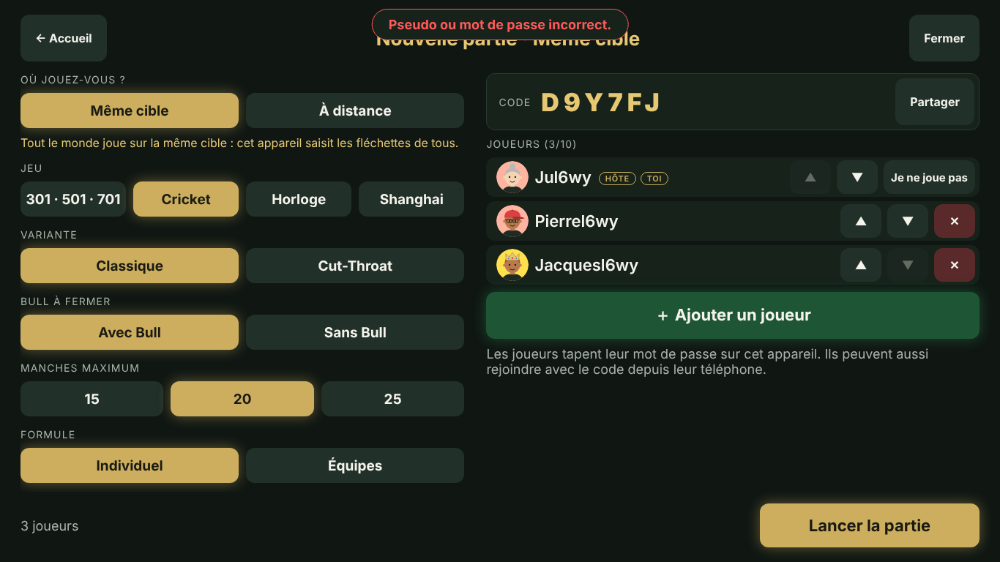
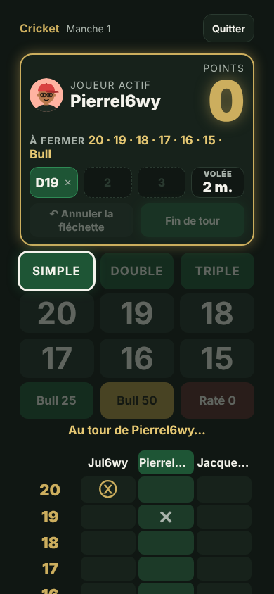
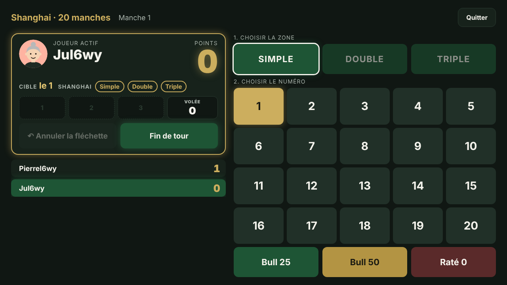

# Jouer en ligne

Depuis la version « tout en ligne », l'appli n'a plus de profils propres à la borne : chaque joueur a un
compte en ligne (pseudo + mot de passe) et toutes les parties sont enregistrées sur le serveur. On a donc le
même compte et les mêmes stats que l'on joue ensemble sur la même cible ou chacun chez soi.

Adresse : https://trem-dragooon.julien-charrier01.workers.dev (borne, PC ou téléphone).

| Salle d'attente sur la borne (même cible) | Suivi sur un téléphone | À distance sur un PC 13 pouces |
| --- | --- | --- |
|  |  |  |

## Deux façons de jouer

| | Même cible | À distance |
| --- | --- | --- |
| Qui saisit | L'appareil qui a créé la partie (la borne) saisit pour tout le monde | Chacun saisit ses fléchettes sur son appareil, à son tour |
| Ajouter les joueurs | Sur la borne : **＋ Ajouter un joueur**, choisir son pseudo et taper son mot de passe, ou **Nouveau joueur** pour créer un compte sur place | Chacun rejoint avec le code ou le lien partagé |
| Téléphones | Peuvent rejoindre avec le code pour suivre les scores, sans saisir | Indispensables : c'est là qu'on saisit |

Le lieu se choisit sur l'accueil (il est retenu sur l'appareil) et peut être changé dans la salle d'attente.
Le compte connecté sur l'appareil est l'hôte. Sur la borne, s'il ne joue pas, **Je ne joue pas** le retire de
la partie sans le déconnecter.

## Déroulement

1. Se connecter (ou **Créer un compte**, puis choisir son avatar). Le compte reste connecté sur l'appareil.
2. Choisir **Même cible** ou **À distance**, puis le jeu : 301 · 501 · 701, Cricket, Horloge ou Shanghai.
3. Dans la salle d'attente, l'hôte règle la partie comme sur l'ancienne borne : score de départ, sortie,
   variantes de chaque jeu, individuel ou équipes (tirage au sort ou à la main), ordre de passage (tiré au
   sort ou ordre de la liste, modifiable avec ▲ ▼). Seul, c'est une partie d'entraînement.
4. **Lancer la partie**. Annuler une fléchette : l'hôte peut toujours ; à distance, le joueur peut aussi
   annuler la sienne.
5. **Quitter** : l'hôte peut **Arrêter la partie** (elle compte comme abandonnée dans les stats). En fin de
   partie : **Rejouer** ou **Changer les réglages**.

Coupure réseau : l'appli se reconnecte seule. Page fermée ou rechargée : l'accueil propose **Reprendre la
partie**. Si l'hôte part, le joueur suivant devient hôte. Une partie sans activité est effacée au bout de
12 heures.

## Comptes et statistiques

Pseudo unique (sans tenir compte des majuscules), mot de passe d'au moins 6 caractères. Chaque partie
terminée ou arrêtée est enregistrée pour tous ses joueurs, quel que soit l'appareil. **Joueurs et
classements** montre les classements et les fiches de tout le monde.

Sécurité : seule une empreinte du mot de passe est stockée (PBKDF2-SHA256, 100 000 tours, sel par compte).
Après 10 essais ratés, le pseudo est bloqué 15 minutes, y compris quand on l'ajoute sur la borne. Pas
d'e-mail, donc pas de « mot de passe oublié » : c'est l'administrateur qui donne un mot de passe provisoire
(voir ci-dessous). Chacun change son mot de passe depuis l'accueil (**Mot de passe**) ; ses autres appareils
sont alors déconnectés.

## Espace administrateur

Le bouton **Administration** (accueil) n'apparaît que pour les pseudos listés dans `ADMINS`
(`server/wrangler.toml`, séparés par des virgules). Un pseudo administrateur est attaché pour de bon au
compte qui le porte : changer de pseudo ensuite ne donne pas l'accès à celui qui reprendrait l'ancien.
Retirer un pseudo de `ADMINS` (puis remettre en ligne) retire l'accès à son compte.

- liste de tous les comptes : date de création, date de dernière utilisation (connexion, ouverture de
  l'appli ou partie terminée, à 10 minutes près ; pour les comptes d'avant le suivi, dernière connexion
  connue), nombre de parties ;
- **Reset stats** : le compte est retiré de toutes ses parties, qui restent valables pour ses adversaires ;
- **Reset mot de passe** : crée un mot de passe provisoire (8 caractères) à transmettre au joueur, et
  déconnecte ses appareils ;
- **Supprimer** : le compte disparaît, ses parties restent pour les autres au nom « Joueur supprimé ».
  On ne peut pas supprimer son propre compte.

## Reprendre les stats de la borne

Les parties jouées avant le passage en ligne sont dans le navigateur de la borne. Pour les rattacher aux
comptes, une seule fois, sur la borne :

```powershell
cd $HOME\trem-dragooon
git pull
npm.cmd install
npm.cmd run build:borne   # même appli, qui parle au serveur en ligne
npm.cmd run preview       # http://localhost:4173, là où sont les anciennes données
```

Ouvrir http://localhost:4173, se connecter, puis **Récupérer les stats de la borne** : choisir son ancien
profil et valider. Chacun fait de même avec son compte (se déconnecter, se connecter avec le compte suivant).
Une partie jouée à plusieurs est rattachée à chaque compte qui récupère son profil ; recommencer ne crée pas
de doublon.

Ensuite, la borne peut ouvrir directement l'adresse en ligne (voir `technique.md`, configuration kiosque) :
plus besoin de serveur local.

## Fonctionnement technique

| Élément | Rôle |
| --- | --- |
| `src/game-setup/setup.ts` | Réglages d'une partie (jeu, options, équipes, ordre), validés de la même façon par l'appli et le serveur. |
| `src/online/protocol.ts` | Messages échangés (JSON sur WebSocket), codes de partie. |
| `src/online/room.ts` | Règles d'une partie : arrivée, joueurs ajoutés sur place, hôte, lancement, qui peut saisir. Pur et testé (`room.test.ts`). |
| `src/online/useOnlineRoom.ts`, `api.ts` | Connexion de l'appli au serveur, reconnexion automatique, adresse du serveur. |
| `src/ui/screens/Room.tsx`, `Setup.tsx` | Salle d'attente, réglages, ajout des joueurs ; la partie réutilise l'écran de jeu. |
| `src/ui/screens/ImportLocal.tsx` | Reprise des stats de la borne. |
| `server/worker.ts` | Cloudflare Worker : sert l'appli et l'API. Un Durable Object par code garde l'état de la partie. |
| `server/accounts.ts` | Comptes et parties : un Durable Object unique stocké en SQLite (inclus dans l'offre gratuite). |
| `scripts/recette-en-ligne.cjs` | Recette automatisée : borne, téléphone et PC 13 pouces. |

Le serveur applique le même moteur que l'appli : il rejoue chaque fléchette reçue et refuse celles qui ne
viennent pas du bon appareil. L'appli ne fait qu'afficher l'état qu'il renvoie.

`npm run build:borne` lit `.env.borne`, qui donne l'adresse du serveur (`VITE_API_URL`) ; le serveur
accepte les appels venant de http://localhost:4173.

## Essayer en local

```bash
npm install
npm run online:dev                         # construit l'appli et lance le serveur sur http://localhost:8787
node scripts/recette-en-ligne.cjs          # dans un autre terminal (Playwright requis)
```

Sous Windows : `npm.cmd run online:dev`.

## Mettre à jour le serveur

```bash
npm run deploy
```

Il faut être connecté à Cloudflare (`npx wrangler login`, ou la variable `CLOUDFLARE_API_TOKEN`). L'offre
gratuite couvre largement un groupe d'amis (100 000 requêtes par jour, Durable Objects inclus).
