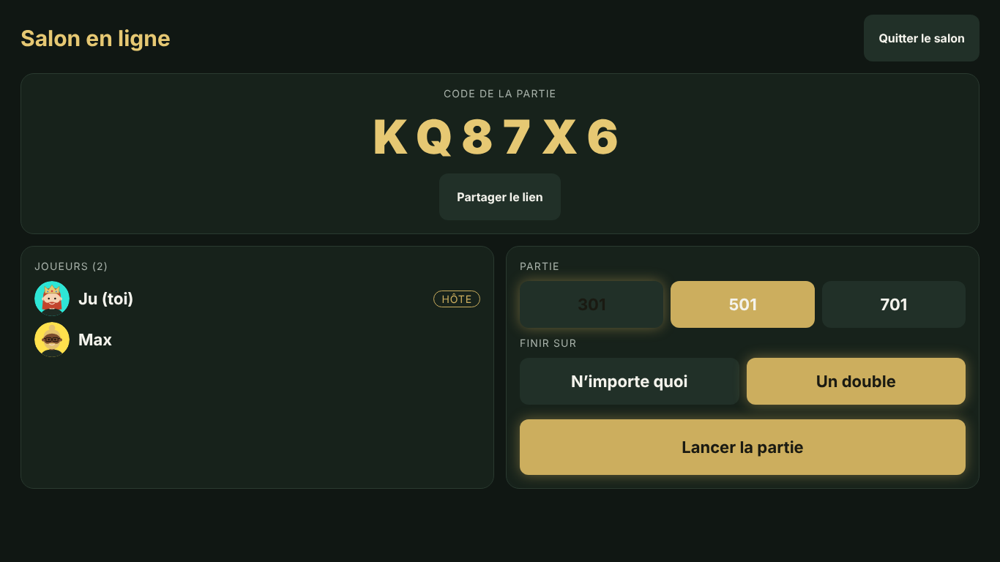
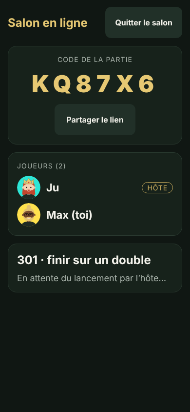
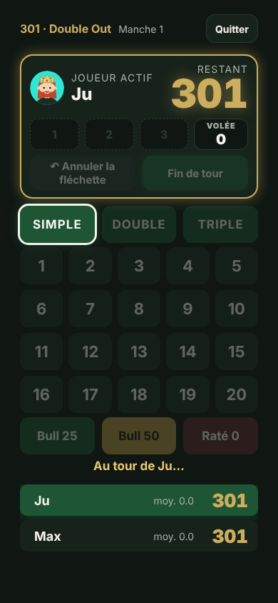

# Jouer en ligne entre copains

Chacun joue chez lui devant sa cible et saisit ses fléchettes sur son téléphone (ou un PC).
L'hôte crée une partie, l'appli affiche un code de 6 caractères, les autres le tapent (ou ouvrent le lien
partagé) et arrivent dans la salle d'attente. Tout le monde voit le tableau des scores en direct.

Ce premier lot couvre le **301 / 501 / 701** en individuel, de 2 à 10 joueurs. La borne garde son
fonctionnement hors ligne : le mode en ligne est un bouton de plus sur l'accueil.

| Salle d'attente (borne, hôte) | Salle d'attente (téléphone) | Partie (téléphone) |
| --- | --- | --- |
|  |  |  |

## Déroulement

1. Accueil → **Jouer en ligne** → choisir son joueur (un profil de l'appareil, ou « Nouveau joueur »).
2. L'hôte appuie sur **Créer une partie** et partage le code ou le lien (« Partager le lien »).
3. Les autres tapent le code puis **Rejoindre**. On ne peut plus rejoindre une fois la partie lancée.
4. L'hôte choisit 301 / 501 / 701 et la sortie (n'importe quoi ou double), puis **Lancer la partie**.
   L'ordre de passage est tiré au sort.
5. Seul le joueur dont c'est le tour peut saisir. Il peut annuler sa dernière fléchette, même après le passage
   au joueur suivant ; l'hôte peut aussi annuler (il fait office d'arbitre).
6. En fin de partie, l'hôte peut **Rejouer** (mêmes joueurs, nouvel ordre) ou revenir à la **Salle d'attente**.

Coupure réseau : l'appli se reconnecte toute seule. Si la page a été fermée ou rechargée, l'accueil propose
**Revenir dans le salon en ligne**. Si l'hôte part, le joueur suivant devient hôte. Un salon sans activité
est effacé au bout de 12 heures.

Pas de compte : chaque appareil reçoit un jeton secret qui lui permet de reprendre sa place. Les parties
en ligne ne sont pas encore archivées dans les statistiques.

## Fonctionnement technique

| Élément | Rôle |
| --- | --- |
| `src/online/protocol.ts` | Messages échangés (JSON sur WebSocket), codes de salon. |
| `src/online/room.ts` | Règles d'un salon : arrivée, reprise, hôte, lancement, arbitrage des fléchettes. Pur et testé (`room.test.ts`). |
| `src/online/useOnlineRoom.ts` | Connexion de l'appli au salon, reconnexion automatique. |
| `src/ui/screens/Online.tsx` | Écrans « Jouer en ligne » et salle d'attente ; la partie réutilise l'écran de jeu existant. |
| `server/worker.ts` | Cloudflare Worker : sert l'appli et crée les salons. Un Durable Object par code garde l'état du salon. |
| `scripts/recette-en-ligne.cjs` | Recette automatisée : une borne et un téléphone jouent une partie complète. |

Le serveur applique exactement le même moteur que l'appli : il rejoue chaque fléchette reçue et refuse
celles d'un joueur dont ce n'est pas le tour. L'appli ne fait qu'afficher l'état qu'il renvoie.

## Essayer en local

```bash
npm install
npm run online:dev                         # construit l'appli et lance le serveur sur http://localhost:8787
node scripts/recette-en-ligne.cjs          # dans un autre terminal (Playwright requis)
```

Ouvrir http://localhost:8787 dans deux fenêtres (une en navigation privée) pour jouer contre soi-même.
Sous Windows : `npm.cmd run online:dev`.

## Mettre en ligne (Cloudflare, gratuit)

À faire une seule fois :

1. Créer un compte gratuit sur https://dash.cloudflare.com/sign-up.
2. Dans le dossier du projet : `npx wrangler login` (ouvre le navigateur pour autoriser).

Puis à chaque mise à jour :

```bash
npm run deploy
```

La commande affiche l'adresse publique, de la forme `https://trem-dragooon.<ton-sous-domaine>.workers.dev`.
C'est ce lien qu'on envoie aux copains. Un nom de domaine à soi peut être branché plus tard dans le tableau
de bord Cloudflare (Workers → trem-dragooon → Domaines).

L'offre gratuite couvre largement un groupe d'amis (100 000 requêtes par jour, Durable Objects inclus).
