# TREM-DRAGOOON · Guide utilisateur

Livrable 05 · version 0.1.0 · octobre 2026

TREM-DRAGOOON compte les points de vos parties de fléchettes sur l'écran tactile. Tout se fait au doigt : il
suffit d'appuyer sur la zone touchée par chaque fléchette, l'application calcule le reste.

## 1. Démarrer

L'application s'ouvre sur l'accueil.

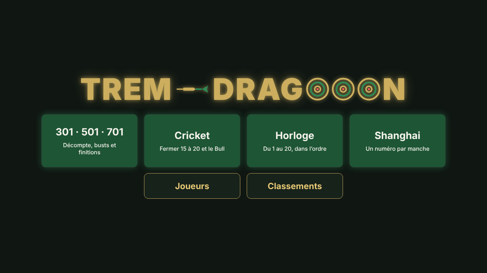

- **Les quatre grandes tuiles** lancent une nouvelle partie : 301 / 501 / 701, Cricket, Horloge ou Chiffre aléatoire.
- **Reprendre la partie en cours** apparaît si une partie n'est pas terminée. Elle est retrouvée telle quelle,
  même après une coupure de courant ou un redémarrage.
- **Joueurs** ouvre la liste des profils, **Classements** les classements.

> Le démarrage automatique en plein écran au lancement du PC (mode kiosque) arrive au lot 5. En attendant,
> lancez l'application comme indiqué dans la [documentation technique](technique.md#3-installation) et
> appuyez sur F11 dans Edge pour passer en plein écran.

## 2. Créer les joueurs

Chaque joueur a un profil : un surnom, une couleur et un avatar. Le profil est obligatoire, c'est lui qui
porte les statistiques. On peut avoir **20 profils** au plus ; le compteur est à côté du titre **Joueurs**.
Au-delà, supprimez un profil pour en créer un autre.

Depuis **Joueurs**, appuyez sur **＋ Nouveau joueur**. Vous pouvez aussi créer un joueur directement au
moment de lancer une partie.

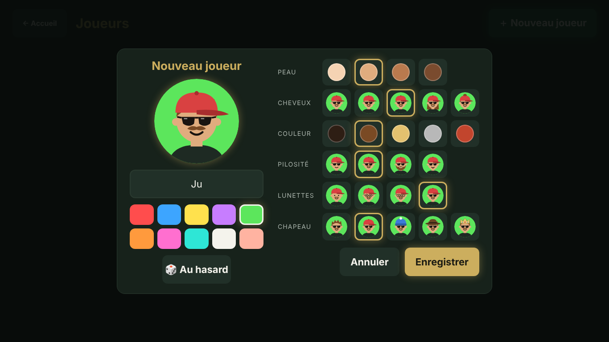

1. Tapez le surnom (16 caractères au plus). Le clavier tactile de Windows s'ouvre en touchant la case.
   Deux joueurs ne peuvent pas avoir le même surnom.
2. Choisissez la couleur de fond.
3. Composez l'avatar ligne par ligne : peau, cheveux, couleur des cheveux, pilosité, lunettes, chapeau.
   **🎲 Au hasard** tire un avatar au sort.
4. Appuyez sur **Enregistrer**.

Pour **modifier** un joueur, ouvrez sa fiche depuis **Joueurs**, puis **Modifier**.

Pour **supprimer** un joueur, ouvrez sa fiche, puis **Supprimer**. Une confirmation est demandée. Le surnom et
l'avatar sont effacés définitivement. Les parties jouées restent dans l'historique des autres joueurs, sous
le nom « Joueur supprimé », pour que leurs résultats restent justes.

## 3. Lancer une partie

Touchez le mode voulu sur l'accueil. L'écran de préparation s'ouvre.

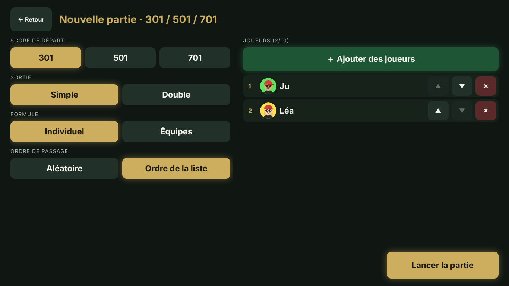

**À gauche, les règles du mode** (voir le détail au chapitre 5), puis :

- **Formule** : Individuel ou Équipes. En équipes, choisissez de 2 à 5 équipes, puis touchez la couleur d'un
  joueur pour le changer d'équipe, ou **Tirer les équipes au sort**. Les équipes peuvent avoir des tailles
  différentes.
- **Ordre de passage** : Aléatoire, ou Ordre de la liste.

**À droite, les joueurs** : **＋ Ajouter des joueurs** ouvre la liste des profils. Touchez chaque joueur à
ajouter, ou **Nouveau joueur** pour en créer un, puis **Terminé**.

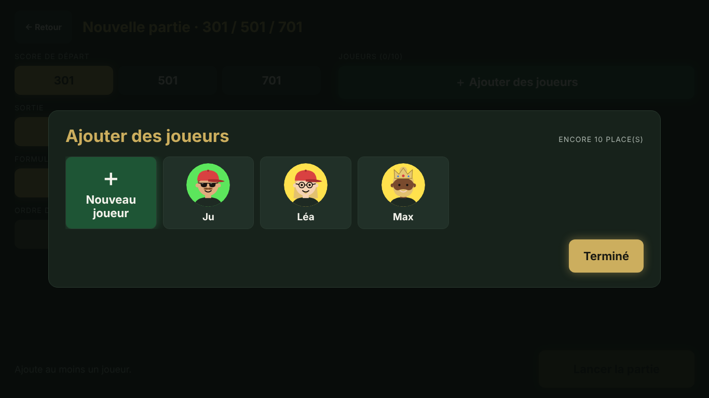

Dans la liste, ▲ et ▼ changent l'ordre et ✕ retire un joueur. De 1 à 10 joueurs par partie. Seul, c'est une
**partie d'entraînement** : elle compte dans vos statistiques, mais pas dans les victoires ni les classements.

Appuyez sur **Lancer la partie**. Le bouton reste grisé tant que la configuration n'est pas valable, et la
raison est écrite à sa gauche.

## 4. Saisir les fléchettes

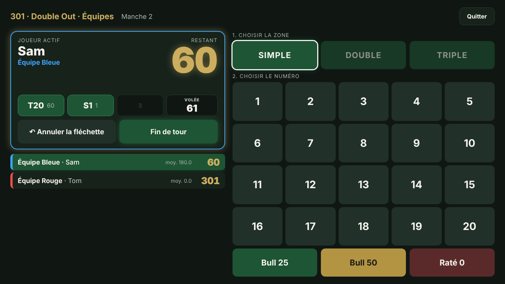

Pour chaque fléchette :

1. **Choisissez la zone** : Simple (par défaut), Double ou Triple.
2. **Touchez le numéro**. La fléchette est enregistrée et la zone revient sur Simple.

Le Bull se saisit directement : **Bull 25** (anneau extérieur) ou **Bull 50** (centre). **Raté 0** compte une
fléchette hors cible ou sans point.

En haut à gauche, la carte du joueur actif montre :

- son score ;
- les fléchettes de la volée ;
- au 301/501/701, la finition conseillée quand elle est possible.

Le tableau de tous les joueurs est juste en dessous.

- **↶ Annuler la fléchette** retire la dernière fléchette saisie, même si le tour est déjà passé au joueur
  suivant. On peut annuler plusieurs fois de suite.
- **Fin de tour** termine la volée avant la troisième fléchette, par exemple si une fléchette est tombée.
  Un second appui confirme.
- Un double appui trop rapide sur la même touche ne compte qu'une fois.

Après la troisième fléchette, un bust ou une victoire, l'écran **« À toi de jouer »** annonce le joueur
suivant. Il disparaît seul au bout d'un instant, ou dès qu'on le touche. Pendant cet écran, aucune fléchette
ne peut être saisie par erreur pour le mauvais joueur.

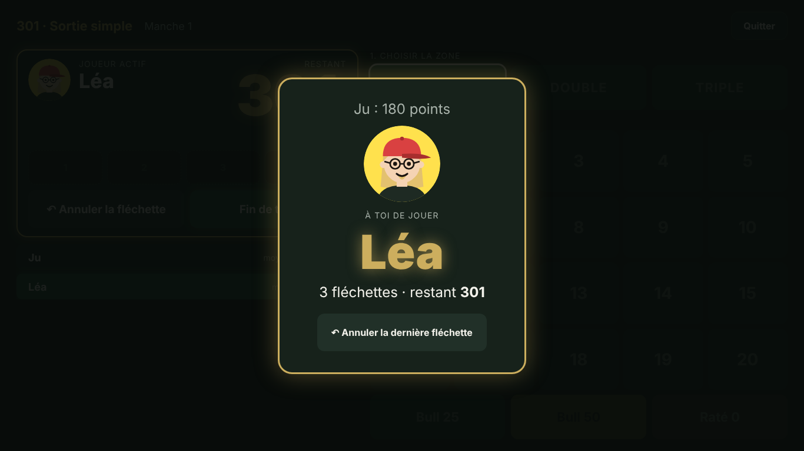

**Quitter** (en haut à droite) demande confirmation. Une partie quittée est enregistrée comme abandonnée :
elle apparaît dans l'historique, mais ne compte ni en victoire ni en défaite.

À la fin de la partie, l'écran de résultat donne le vainqueur et le classement.

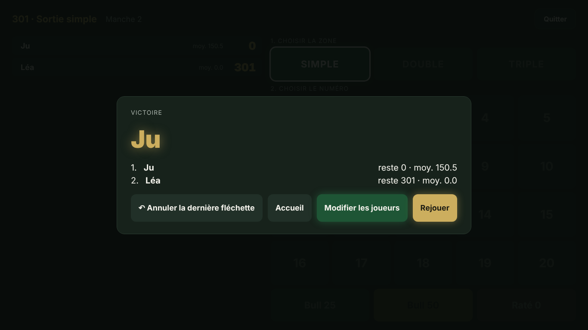

- **↶ Annuler la dernière fléchette** rouvre la partie en cas d'erreur de saisie.
- **Rejouer** relance avec les mêmes joueurs, règles et équipes, et un nouvel ordre de passage tiré au sort.
- **Modifier les joueurs** revient à la préparation avec les mêmes réglages.
- **Accueil** termine.

## 5. Les modes de jeu

Les règles exactes sont dans [regles.md](regles.md). En résumé :

### 301 / 501 / 701

Chacun part du score choisi et le fait descendre à zéro exactement.

- **Sortie simple** : n'importe quelle fléchette peut finir.
- **Sortie double** : la dernière fléchette doit être un double, ou le Bull 50.

Dépasser zéro, ou rester à 1 en sortie double, est un **bust** : le score revient à ce qu'il était au début de
la volée et le tour passe. Le premier à zéro gagne.

### Cricket

Il faut fermer le 15, le 16, le 17, le 18, le 19, le 20 et, selon l'option, le Bull. Un numéro est fermé à
3 marques : un simple vaut 1 marque, un double 2, un triple 3. Les marques en plus rapportent des points tant
qu'un adversaire n'a pas fermé ce numéro. On gagne en fermant tout avec au moins autant de points que chaque
adversaire.

Le pavé ne montre que les numéros utiles, avec un bouton Raté.

- **Variante Cut-Throat** : les points vont aux adversaires qui n'ont pas fermé le numéro, et c'est le plus
  petit score qui gagne.
- **Manches maximum** : passé ce nombre de manches, le classement se fait aux points.

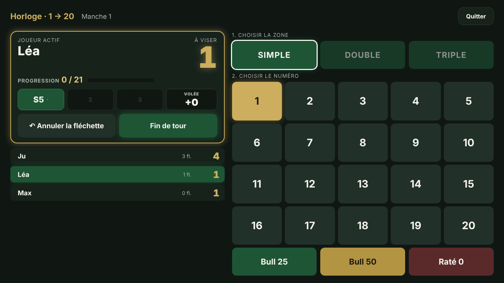

### Horloge

Il faut toucher les numéros dans l'ordre choisi : 1 → 20, 20 → 1 ou l'ordre du cadran. Ici, pas de pavé :
pour chaque fléchette, touchez **✓ Touché** si le numéro visé est atteint, sinon **✕ Raté**.

La cible dessinée montre où en est le joueur :

- en or, le numéro à viser ;
- en vert, les numéros déjà réussis.

Options :

- **Zone à toucher** : toutes les zones, doubles seulement, ou triples seulement.
- **Double et triple font avancer de 2 et 3** : trois boutons Touché Simple, Double et Triple remplacent
  Touché.
- **Bull final** : aucun, 25 ou 50, ou bien 25 puis 50.

Quand un joueur termine, on finit la manche en cours. Celui qui a terminé avec le moins de fléchettes gagne,
et les records se comptent en nombre de fléchettes.

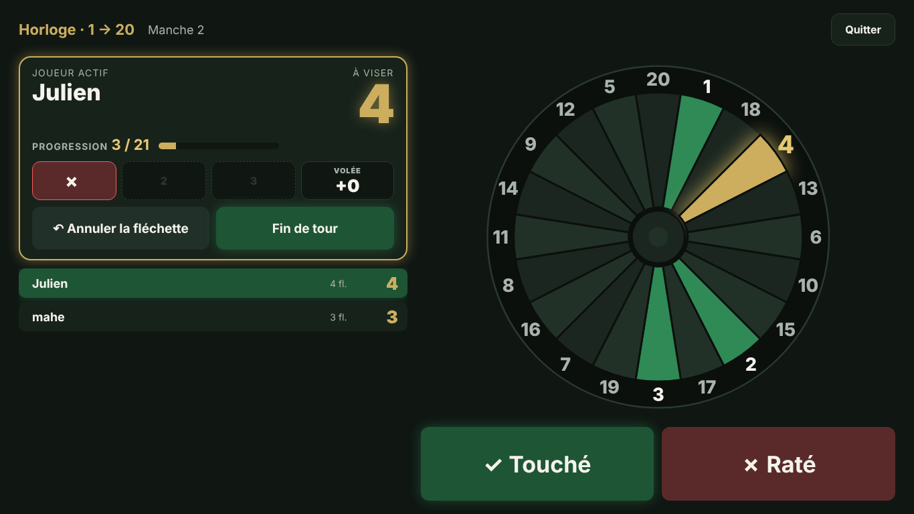

### Chiffre aléatoire

On joue 10, 15 ou 20 tours. À chaque tour, la borne tire au sort un numéro à viser, de 1 à 20 ou le Bull,
jamais deux fois de suite le même. Seules les fléchettes sur ce numéro rapportent : simple, double ou triple
(25 ou 50 pour le Bull). Après le dernier tour, le plus gros total gagne.

Comme à l'Horloge, la cible est dessinée avec le numéro à viser allumé en or. On touche **Simple**,
**Double**, **Triple** (ou **25**, **50** pour le Bull) quand la fléchette est sur le numéro, **Raté** sinon.

### En équipes

- Le score est commun à l'équipe.
- Les équipes jouent chacune leur tour, et les membres d'une équipe se relaient.
- Une victoire d'équipe compte pour chacun de ses membres.

## 6. Statistiques et classements

Toutes les statistiques sont recalculées à partir des parties enregistrées. Quand une valeur ne peut pas
être calculée (pas assez de parties sur la période, par exemple), l'écran affiche **non disponible**, jamais
un 0 trompeur. L'application note chaque fléchette (zone et numéro) mais pas la cible que le joueur visait :
elle ne donne donc ni précision sur une cible, ni taux de ratés, ni carte de chaleur.

### Fiche joueur

Depuis **Joueurs**, touchez un joueur pour ouvrir sa fiche. Les filtres en haut s'appliquent à tous les onglets :

- le **mode** (Tous, 301/501/701, Cricket, Horloge, Chiffre aléatoire) ;
- la **formule** (Tout, Individuel, Équipes) ;
- la **période** : Tout, 30 jours, 90 jours, 1 an, ou **Dates…** pour choisir le début et la fin.

#### Résumé

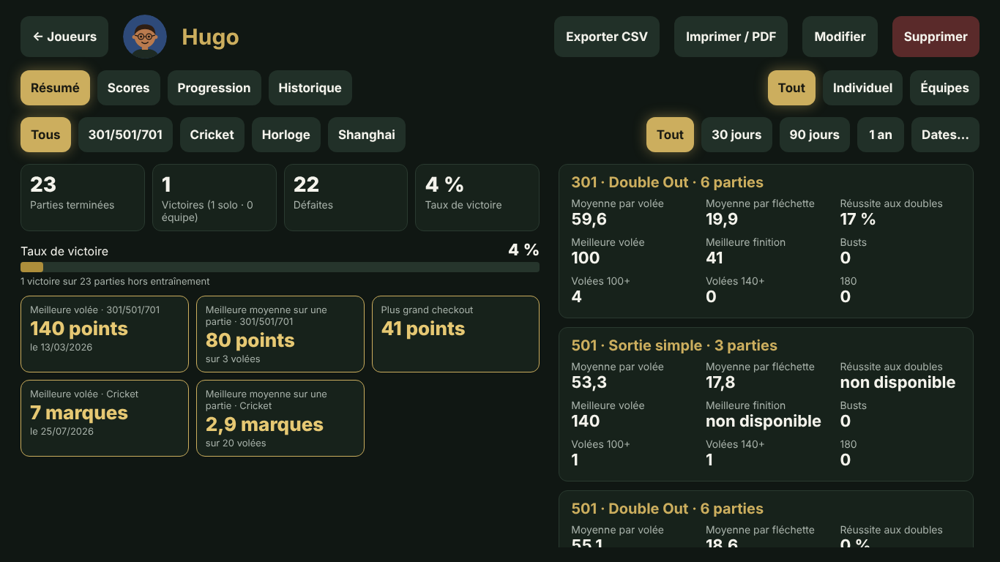

Parties terminées, victoires, défaites et taux de victoire, puis les **cartes de records** : meilleure volée et
meilleure moyenne sur une partie (au moins 3 volées) pour chaque mode, et plus grand checkout au 301/501/701.
À droite, une carte par variante et par mode (moyennes, réussite aux doubles, meilleure finition, busts,
volées à 100, 140 et 180…).

#### Scores

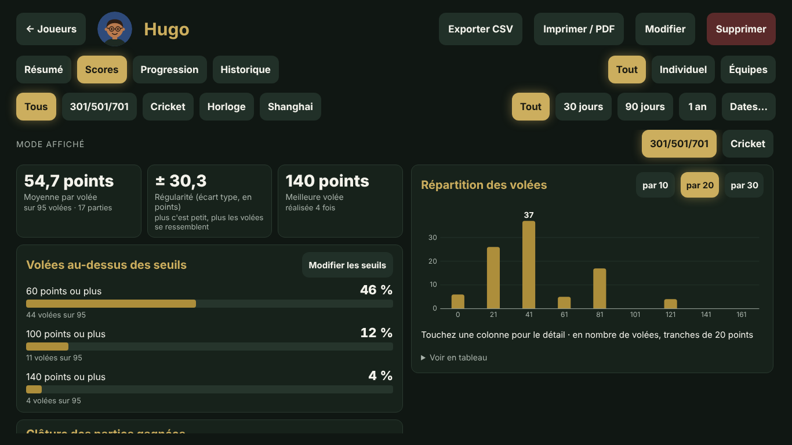

Avec le filtre **Tous**, choisissez le mode affiché à droite (le plus joué est proposé d'abord).

- **Moyenne par volée**, avec le nombre de volées et de parties sur lesquelles elle repose.
- **Régularité** : l'écart type des volées. Plus il est petit, plus les volées se ressemblent.
- **Meilleure volée** et le nombre de fois où elle a été réalisée.
- **Volées au-dessus des seuils** : la part des volées à 60, 100 et 140 points ou plus. **Modifier les
  seuils** change ces trois valeurs ; elles sont gardées sur le PC. Au Cricket, les seuils sont 3, 5 et 7
  marques.
- **Répartition des volées** : un histogramme par tranches de 10, 20 ou 30 points (une colonne par nombre de
  marques au Cricket). Touchez une colonne pour son détail, ou **Voir en tableau**.
- **Clôture des parties gagnées** (301/501/701) : volées et fléchettes moyennes pour finir, et la partie la plus
  rapide. Seules les victoires en individuel comptent : en équipe, la fin dépend aussi des partenaires.

Au 301/501/701, une volée en bust compte pour 0. Au Cricket, une volée vaut ses marques.

#### Progression

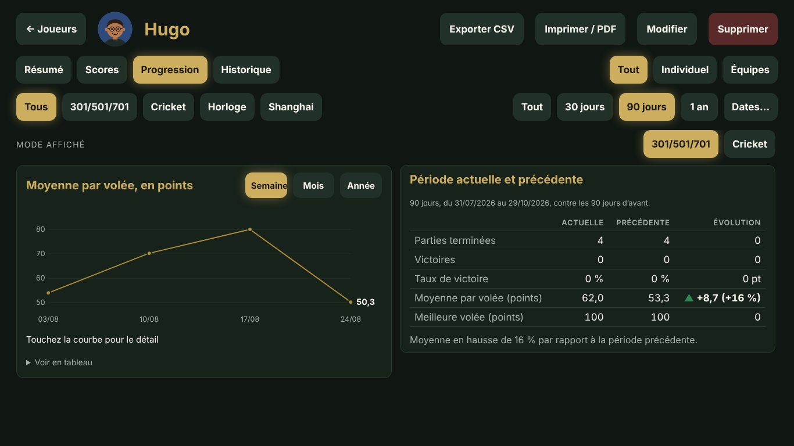

- La **courbe** de la moyenne par volée, par semaine (à partir du lundi), par mois ou par année. Touchez-la pour
  le détail d'un point.
- Le tableau **Période actuelle et précédente** compare la période choisie à la période de même durée juste
  avant : parties, victoires, taux de victoire, moyenne et meilleure volée, avec l'évolution (▲ en hausse,
  ▼ en baisse). Sans période choisie, il compare les 30 derniers jours aux 30 jours d'avant.

L'Horloge n'a pas d'onglet Scores ni Progression : on n'y saisit que Touché ou Raté. Ses records sont dans le
Résumé.

#### Historique, export et impression

- **Historique** : toutes les parties, abandonnées comprises.
- **Exporter CSV** télécharge un fichier avec une ligne par volée (date, mode, manche, fléchettes, valeur,
  issue), pour les filtres en cours. Il s'ouvre dans Excel.
- **Imprimer / PDF** imprime l'onglet affiché sur fond blanc. Choisissez « Enregistrer au format PDF » comme
  imprimante pour obtenir un PDF.

### Classements

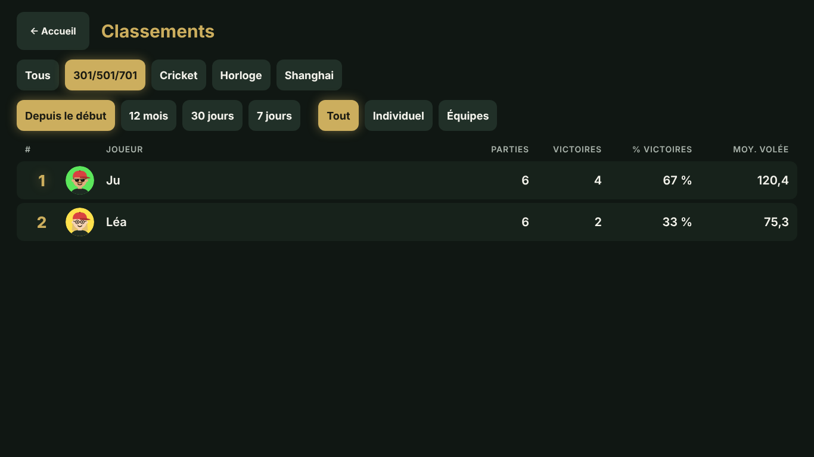

Choisissez le mode, la formule et la période (mêmes choix que sur la fiche joueur), puis **Classer par** :

- **Victoires** : taux de victoire, puis nombre de victoires (tous les modes) ;
- **Moyenne** : moyenne par volée ;
- **Record de volée** : meilleure volée ;
- **Progression** : écart de moyenne avec la période précédente de même durée. Il faut choisir une période.

Les trois derniers ne sont possibles qu'avec un mode à score (301/501/701, Cricket ou Chiffre aléatoire). Il faut
**5 parties terminées** pour être classé ; les autres joueurs sont listés à part. L'entraînement ne compte
jamais. Quand une valeur manque, le joueur est placé en fin de liste avec « non disponible ».

Si une partie est corrigée ou rouverte, les statistiques sont recalculées, sans doublon.

## 7. Problèmes courants

| Problème | Que faire |
| --- | --- |
| Une fléchette a été mal saisie | **↶ Annuler la fléchette**, puis ressaisir. Ça marche même après le passage au joueur suivant, et même sur l'écran de victoire. |
| La partie s'est fermée (coupure, fausse manipulation) | Rouvrir l'application, puis **Reprendre la partie en cours** sur l'accueil. |
| « Lancer la partie » reste grisé | Lire le message à gauche du bouton : il manque un joueur, ou il y a trop d'équipes pour le nombre de joueurs. |
| Un joueur n'apparaît pas dans « Ajouter des joueurs » | Il est déjà dans la partie, ou son profil a été supprimé. Sinon, le créer avec **Nouveau joueur**. |
| L'accueil affiche « Stockage indisponible » en rouge | Le navigateur bloque le stockage (navigation InPrivate, par exemple). Ouvrir l'application dans une fenêtre normale d'Edge, sinon profils et statistiques seront perdus à la fermeture. |
| Les joueurs et les statistiques ont disparu | Les données sont rangées dans le navigateur, **par compte Windows**. Vérifier que la session Windows est la même qu'avant, et ne pas effacer les « données de navigation » d'Edge. La sauvegarde dans un fichier arrive au lot 5. |
| L'écran affiche l'ancienne version après une mise à jour | Appuyer sur Ctrl+F5 dans Edge. |
| Le clavier tactile ne s'ouvre pas pour le surnom | Toucher la case du surnom, ou activer le clavier tactile dans la barre des tâches de Windows. |

## 8. Ce qui arrive au lot 5

- Démarrage automatique en plein écran (mode kiosque).
- Sauvegarde et restauration des données dans un fichier.
- Code administrateur à 4 chiffres.
- Réglages à l'écran : durée et désactivation des animations.
- Sons (bust, victoire, triple).
- Correction d'une volée ancienne, au-delà de la dernière fléchette.
- Écran de veille qui fait défiler les classements.
